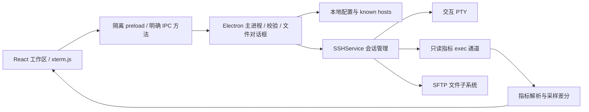

# 技术选型与工程架构

## 0.6.0 命令与标签状态

`src/commands.ts` 负责旧命令迁移、分类移动、模糊排序、会话发送和历史记录；`CommandWorkspace` 管理共享分类和右侧 CodeMirror 编辑器；`CommandInput` 管理当前连接的 100 条历史及候选键盘交互。输入栏与命令库分别持有草稿，单击命令库不改写输入栏。

发送通过已有受限 `write` IPC，不引入任意本地执行接口。发送前快照当前/全部已连接会话，用 Promise.allSettled 区分成功和失败；仅为成功接收的 profile ID 写历史，同一 profile 的多个会话历史去重。多行文本转换成 PTY 回车，按选项补末尾 CR。清空编辑器时检查当前草稿仍等于发送快照，避免清除发送期间新输入。

标签 ID 独立于 SSH 会话数组，新标签以 `new:` 标识。`NewTab` 显示已保存配置对应的最近连接；成功连接后替换发起操作的新标签并更新最近记录。终端组件始终保留在同一个容器，切换到新标签只隐藏它们，避免 PTY 输出与滚动缓存丢失。最近列表只保存 profile ID 与时间，不复制凭据。

`PermissionEditor` 使用 Unix 权限位生成九个复选框，勾选时只修改对应位并保留高位；无效的八进制输入不能提交。文件夹右键 cd 使用共享单引号转义和正常会话发送入口，权限修改仍走 SFTP API。

## 选型决策

| 层         | 选型                          | 原因与取舍                                                                                                  |
| ---------- | ----------------------------- | ----------------------------------------------------------------------------------------------------------- |
| 桌面运行时 | Electron                      | Node 生态直接接入成熟 SSH 实现，统一终端渲染，Windows 打包链完整。代价是比原生/Tauri 更大的体积与内存占用。 |
| 界面       | React + TypeScript + Vite     | 便于构建多面板、图表、连接表单与类型化状态；静态资源随应用打包，无运行时 CDN。                              |
| 终端       | xterm.js + Fit / Search addon | VT 终端、PTY 尺寸同步、滚动缓存、搜索，支持远端交互程序。                                                   |
| SSH / SFTP | ssh2                          | 单个连接承载交互 Shell、独立 exec 与 SFTP 子系统，支持主机密钥验证、密码/私钥/Agent。                       |
| 指标展示   | SVG / CSS + 纯函数解析        | 小型折线、环形、条形图不引入大型图表框架；便于测试 CPU、网络、磁盘差分。                                    |
| 配置       | 本地 JSON + 串行原子替换      | 当前数据量很小，无数据库原生模块 ABI 负担。未来跨设备同步/审计可以引入 SQLite。                             |
| 验证       | Vitest + Playwright Electron  | 纯逻辑测试、本地协议集成与真实打包窗口测试分别覆盖不同故障。                                                |
| 打包       | electron-builder portable     | Windows x64 无安装便携包；可进一步扩展 NSIS 安装程序、签名和自动更新。                                      |

评估过 Tauri：运行体积更小，但本项目首版重点是终端与 SSH/SFTP 的快速可靠集成；采用 Electron 避免额外 Rust 绑定和多个跨语言边界。WPF/WinUI 更适合严格 Windows 原生要求，但本项目希望保留跨平台界面与终端复用。

官方依据：[Electron 安全建议](https://www.electronjs.org/docs/latest/tutorial/security)、[进程沙箱](https://www.electronjs.org/docs/latest/tutorial/sandbox)、[xterm addon](https://xtermjs.org/docs/guides/using-addons/)、[ssh2 API](https://github.com/mscdex/ssh2)。具体已安装版本由 `package-lock.json` 固定。

## 分层

`src/shared.ts` 定义通信契约与配置校验；`electron/ssh.ts` 管理连接生命周期和协议；`electron/metrics.ts` 负责固定采集脚本与 Linux 解析；`src/io.ts` 负责设备 I/O 差分。`src/Terminal.tsx` 隔离终端生命周期；`src/App.tsx` 负责工作区编排，不含演示数据。

## 连接生命周期

1. 主进程重新校验连接参数。
2. `hostHash: sha256` 对服务器密钥计算指纹；首次连接核对后持久化，已有指纹不一致则拒绝。
3. 认证成功后申请 PTY；先暂停输出，待渲染端订阅事件并调用 `start` 后恢复，避免首屏输出丢失。
4. 用户输入通过受限 IPC 方法写入 PTY。登录命令只有用户开启自动执行时才发送。
5. 活动会话按设置采集指标，`exec` 有 12 秒超时、输出上限与请求去重。
6. 会话关闭时清理客户端，界面保留断开状态；应用退出关闭所有连接并等待配置写入。

## 指标口径

- CPU：`/proc/stat` 前八个计数差分；idle 包括 iowait。首个采样是基线，显示 0。
- 内存：`1 - MemAvailable / MemTotal`。缓存单列，交换空间独立计算。
- 网络：`/proc/net/dev` 字节增量 / 实际采样秒数；计数器重置时钳制为 0。
- 磁盘容量：`df -Pk`，按挂载点显示；这不是每个任意子目录的文件大小扫描。
- I/O：`/proc/diskstats` 扇区按 512 字节换算，采样差分生成吞吐、IOPS、busy%。整盘与映射设备分别显示，不跨层累加。
- 进程：`ps` CPU 排序前 30 个；RSS 换算字节，CPU 是 ps 的生命周期平均值。
- 图表：CPU 和网络最多保存 40 个活动会话采样，不承诺长期时序数据。

## 安全与数据

渲染进程启用 `contextIsolation`、`sandbox`，关闭 `nodeIntegration`。preload 不暴露通用 IPC 或任意本地执行能力。主进程检查 IPC 发送窗口和主框架，并验证参数。禁止新窗口和页面跳转，设置 CSP，所有依赖随包加载。

密码/口令不写入配置；私钥仅由主进程从用户指定位置读取。SFTP 文件传输通过系统对话框选择本地文件。远程路径通过 SFTP API 传递，生成 Shell 查看命令时使用单引号转义。未知指纹确认与覆盖远程同名文件是产品操作流程的一部分。

生产配置位于 `%USERPROFILE%/.EluShell`：`settings.json` 保存连接、分类、命令库、编辑器配置与草稿、每连接历史、最近连接和外观；`known-hosts.json` 保存指纹。加密凭据独立保存在 `credentials.json`，设置文件不包含明文密码。

## 后续扩展接口

0.2.0 已拆出 DirectoryTree、TunnelEditor 和 ResizeHandle。SSHService 通过 TunnelManager 管理本地/远程转发的监听与连接生命周期，文件树并发读取复用同一个 SFTP 子系统。目录同步通过当前 Shell PID 查询 `/proc/<pid>/cwd`。后续可增加跳板机、动态转发、传输队列与大列表虚拟滚动；凭据持久化应以系统保险库为前提。RDP 需要独立协议/进程，不应混入 Linux SSH 监控采集器。

## 0.3.0 传输与编辑

- `RemoteFiles` 负责递归 SFTP 遍历、上传/下载、目录和权限操作、文本读取与保存。`TransferManager` 保存最多 150 个任务，向窗口发送节流进度事件；每个任务持有 AbortController。
- `FileActions` 提供目录树/列表共用右键菜单和操作表单。`Transfers` 在会话栏中显示任务与下载位置。`TextEditor` 按需加载 CodeMirror，编辑缓冲不进入 localStorage 或服务器配置。
- 主进程通过原生选择器管理上传源和下载目录；默认 `app.getPath('desktop')/esdownload`。目录设置单独原子写入 `downloads.json`，避免与其他设置保存互相覆盖。打开本地路径只接受已登记的任务或配置目录。
- 编辑文档句柄仅在主进程映射至会话和远程路径；保存 API 不接受任意文件路径。比较远端 SHA-256 与打开/上次保存版本，冲突时拒绝覆盖。写入临时文件后使用 OpenSSH POSIX rename；不支持扩展时尝试标准 SFTP rename。替换失败不先删除原文件。
- UTF-8 验证、4 MiB 文本上限、递归数量/深度限制、Windows 文件名校验和不跟随符号链接都在主进程实施。权限修改与删除不拼接 Shell 命令。
- 取消窗口退出不会先断开 SSH；未保存编辑器的 beforeunload 由原生确认处理。上传/下载中途退出目前不提供恢复队列。

## 0.4.0 配置与进程边界

ConfigStore 将用户数据根目录设为 home/.EluShell。迁移仅复制允许的旧配置文件，文件写入使用排队原子替换；SettingsSchema 校验文件夹引用及环路。凭据单独使用 Electron safeStorage 加解密，密文绑定连接身份，明文不通过读取 API 返回渲染进程。Windows 使用 DPAPI，不含自定义静态密钥。配置导出默认不携带凭据。

ConnectionManager 独立于 App，实现分类树和连接页签。ProcessManager 通过专用只读 IPC 获取完整 ps 表和 /proc 身份/位置；每列排序在前端完成。终止 API 仅接受整数 PID 和数字启动时间，原生确认后再次校验启动时间并发送 SIGTERM；没有通用 Shell 执行 IPC。跨进程启动时间检查降低 PID 复用误杀风险，但不等同于 Linux pidfd 原子操作。

## 0.4.1 进程位置解析

采集增加 /proc/PID/cwd 和十六进制编码的 /proc/PID/cmdline，避免 ps 展示文本丢失参数边界。process-location.ts 区分服务入口、工作目录、解释器可执行文件：Java 解析启动模式与 JVM 参数；Node/Python/dotnet/Shell 识别常见脚本入口，未知启动形式回退至 cwd。不执行服务参数，不从环境库参数推断服务路径。相对路径根据当前 cwd 解析；服务启动后若主动更改 cwd，无法保证还原启动时目录。

ProcessManager 以 location 为位置列的显示、排序和复制字段，详情保留 executable 与 cwd。formatMemory 按字节选择单位，排序仍使用数值字段 memory。

## 0.6.2 启动路径

日常发行增加 NSIS 安装包，安装后直接启动应用目录中的 EXE。electron-builder 的单文件 portable 模板在每次运行前解压、退出后清理临时应用目录；这部分耗时发生在 Electron 启动前，无法通过前端首屏优化消除。

React 新标签页先加载工作区；Terminal/xterm/搜索插件按需导入。Rollup 的 CommonJS 公共辅助代码独立成很小的 runtime chunk，避免入口引用辅助代码时连带加载整个终端 chunk。SSH 输出仍等终端订阅后恢复，延迟加载不提前消耗输出。

ConfigStore 初始化只读取和规范化一次 settings.json，仅首次创建或迁移产生变化时写入；渲染端也跳过首次加载的自动保存。后续用户修改沿用原子写入和退出前 flush。优化方法参考 [Electron 性能指南](https://www.electronjs.org/docs/latest/tutorial/performance)，具体瓶颈以本机启动计时和构建资源依赖验证。

## 0.7 更新服务

`electron/updates.ts` 管理更新状态及独立 updates.json，按需创建 electron-updater 的 NsisUpdater。默认源为空，不构造更新客户端。软件启动先显示工作区，再延迟三秒发起后台检查。检查、下载、安装是三个用户可控阶段，autoDownload 和 autoInstallOnAppQuit 都关闭；便携版不进入应用内更新流程。

preload 只暴露更新状态、配置、检查、下载/取消、忽略和安装方法。主进程校验更新 URL 与 HTTP 开关，更新网络分区禁止未经允许的 HTTP 请求；禁止 web installer 和降级。安装前检查传输、编辑器未保存事件、用户断开会话确认，再完成配置 flush 和备份。安装器自身处理应用文件替换，更新模块不提供通用命令执行或任意文件安装 IPC。

更新源由用户配置 generic HTTP(S) 目录，resources/app-update.yml 只保存缓存目录名称，不含部署地址。服务器部署使用现有 Nginx 静态站，无需额外常驻服务。
